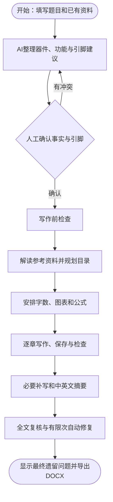

# 论文生成路线：供使用者审核

本地版本：20261018-3。以下按当前 DeepSeek 路线说明，既描述已经落实的行为，也列出尚存在的限制。此文不是论文正文。

## 一、先看完整路线

实际界面仍是三个主要步骤：**准备资料 → 器件分析与引脚确认 → 生成与下载**。目录由生成阶段内部完成，不要求使用者再选一套模板。方案生成与论文生成相互独立，已有方案可以直接用于论文，不必先在网站重新生成方案。

## 二、不同资料情况如何进入流程

| 使用者手里的资料 | 网站如何处理 | 写作前需要确认什么 |
| --- | --- | --- |
| 只有题目 | AI建议器件、功能、主控和连接 | 建议方案是否符合实际制作方向；不能跳过事实和引脚确认 |
| 题目及部分功能/器件 | 保留已给事实，补缺项 | 补充项、不同资料间的冲突 |
| 完整方案 | 粘贴或导入，AI整理为论文资料 | 提取结果和引脚；不强制再用方案生成功能 |
| 完整项目资料 | 结合方案、已选程序、原理图提取结果及测试记录 | 型号、控制对象、供电、引脚是否一致 |
| 没有程序、实物照片或测试记录 | 这些附件本身不阻止生成；以确认方案组织初稿 | 软件描述依据是方案；数值、图片仍需使用者结合实物核对 |
| 有学校任务书/开题报告 | 背景资料入口只提取课题背景与研究方向 | 旧例文和旧功能不能覆盖当前方案 |
| 有学校参考目录/论文模板 | 参考目录入口提取框架与章节写作要求 | OCR不确定文字、占位标题和实际不适用项目 |

“只有题目也能写”意味着系统先补出一份可确认的项目事实，不意味着跳过硬件依据直接编写全文。

## 三、资料优先级

1. **当前项目确认的事实**：题目、器件、功能、引脚、明确提供的程序和测试依据。
2. **学校参考的结构要求**：可辨识的章数、章节次序、标题分组、层级、选型/PCB位置、小结安排和每章内容方向。
3. **必要的论文内容补充**：补齐论证、关键选型、组织说明等；优先放进已有框架，不能把参考改回默认目录。
4. **工作室默认硬件和默认目录**：只在缺少不同的明确信息时使用。

例如：模板要求APP设计，但项目没有APP，可以标记不适用并说明理由；模板把选型放第三章，当前器件允许选型，就留在第三章；不能以“默认第二章选型”为由挪动。模板中旧课题的矿山、维护等例文只作模板内容识别，不能成为当前项目事实。

资料存在真实冲突时，在器件确认阶段显示，由使用者确定实际情况。AI可以提出补充建议，不能暗中更换确认的主控和连接。

## 四、参考目录如何读取和使用

### 4.1 文件进入后的处理

| 输入形式 | 读取方式 | 后续处理 |
| --- | --- | --- |
| 直接粘贴文字、TXT、MD | 读取原文 | AI解读原框架 |
| DOCX文字目录 | 读取段落文字 | AI过滤页码、封面、旧例文及格式说明 |
| DOCX中粘贴的目录截图 | 同时提取文字和内嵌图片，图片本地OCR | 合并后由AI解读 |
| PNG/JPG/WebP/BMP | 本地OCR识别文字 | AI整理编号、层级和章节方向 |
| 文字PDF | 提取文字及换行 | AI解读 |
| 扫描PDF | 渲染后本地OCR | AI解读 |
| 旧版二进制DOC | 明确提示转换 | 在WPS另存为DOCX后导入 |

图片先识字，再交给AI理解结构；不是依靠DeepSeek直接“看图”。OCR组件和中英文识别数据随网站本地提供，不在使用时临时依赖外网CDN。图文混合Word也会读取其中截图。

一次最多12份文件，每份不超过20 MB；PDF最多12页，图片OCR累计最多12页，合并文字不超过5万字。超限明确提示，不截掉后半份要求继续写。

图片先放大、补白和增强对比度；对低清晰度或疑似乱码的识别结果，最多用另一种版面分割方式复核一次。编号仅在上下文充分时恢复，多页内容按章号、小节号整理，不能将1.3当成第13章。

Word里同时存在文字和目录截图时，按小节逐项合并：清晰Word文字优先，截图中可读的具体标题可以替换通用占位标题，并补充文字部分没有的小节。截图乱码不能覆盖同一编号下已经清楚的文字，原写作方向仍保留。文字与截图不会简单前后追加后再交给AI。

先从合并资料中提取胜出的目录骨架，逐项收集绑定章号/小节号的写作说明，再交给AI整理这些说明。封面、旧TOC重复块、示例正文和文献示例不再一起交给AI重新猜目录。AI不能把清晰的标题降成“章节方向”而导致章节丢失；返回结果要与本地骨架核对。

AI解读完成后，结果直接显示在原“参考目录”文本框中，不再另设解读结果编辑框；原导入文字仍在项目内部保留。清晰资料自动进入后续流程；遇到乱码、低识别清晰度、AI警告或原标题/层级不一致，保留候选目录并逐项提示。使用者可不作修改，点击“直接使用此目录”采用当前解读；编辑是可选操作，在同一文本框修改后点击“保存并使用此目录”。采用前暂停文献匹配和正文写作，采用后疑点仅作提示，不再要求先改字。清空文本框会清除当前参考目录及其解读缓存；重新解读以文本框当前显示的内容为准。空目录、无法识别章节或重复小节号仍不能使用；不能失败后套用默认目录。

“AI解读目录”可重做，识别过程中可取消。输入不变时复用解读结果；修改参考原文后重新解读。所有章节的可读标题都进行保真校验；清晰资料的解读遗漏可再修正一次，乱码资料则留给原图核对，避免反复消耗API额度猜字。用户确认后的修订结果作为后续写作依据。

### 4.2 三种框架情况

| 参考情况 | 目录决策 |
| --- | --- |
| 完整清楚 | 沿用章数、章名、职责和层级，把当前项目内容填入；只作必要调整并记录原因 |
| 只提供局部目录或占位框架 | 保留看得出的章数线索、分组、顺序和小结要求，补全缺口；占位名称按项目替换 |
| 完全没有参考 | 使用默认六章：绪论、总体方案、硬件、软件、测试、总结；各章带小结，三级标题随项目变化 |

看到第5章不等于全文只有五章。只有明确总章数或可辨识的最终结论章，才据此确定总数。模板在编号测试章之后另有“结论”，这部分不能被吞进测试小结。

第一章有可读标题时优先保留原分组和标题，不再强制替换成默认四节。学校只给两个二级分组及其三级层级时，背景、现状、主要工作和论文组织可在这些分组内安排；不为默认措辞额外造1.3、1.4。

### 4.3 标题下的说明也要落实

“可给出模块选型说明”“介绍PCB布局与布线规则”等说明绑定原章节/小节，参与目录规划、正文写作和后续修复。小结里回顾“介绍了选型、总体设计、检测”等，不再被误判为小结标题必须重复这些词。

每项参考要求都有对应位置和采用说明：采用、按项目调整、实际不适用。编号不能指向不存在的小节，章节内要求不能无故迁往其他章。若规划及一次修正后仍不合格，在正文写作之前停止，保留已有稿件。

### 4.4 这次学校模板的对应方式

- 第一章保留原有两个二级分组和三级框架，去掉“二级标题/三级标题”等占位名称，按本课题和学校说明命名。
- 第三章中的主控选择、模块选型继续留第三章，器件图和比较表跟随对应选型内容。
- PCB设计继续在第三章，保留布局与布线图位置、EDA工具和规则说明。增补实际模块后小节编号可连续调整，内容位置及采纳关系不能丢失。
- 第四章按项目实际软件安排；没有APP或上位机时不编造它们。
- 测试章后单列的结论整理为独立末章。
- 第一章组织说明从最终目录逐章生成，真实目录有六章就介绍完整六章，不固定写五章。

## 五、硬件、程序和测试依据

默认采用PCB，EDA工具为**嘉立创专业版**。除51等另有约定的情况，主控仍是最小系统开发板，PCB可作为承载板或接口连接板，两者并不冲突。使用者明确写“不使用PCB、仅面包板”或指定其他制图软件时按实际资料处理；不能根据默认项编造板层、尺寸、生产订单或已测量阻抗。

其他已有硬件约定继续生效：开发板5V输入、板载稳压获得3.3V、模块共地、上拉电阻10 kΩ、独立WiFi模块ESP-01S、TFT为1.8寸。明确的不同项目事实应优先；电压和接口最终以已确认硬件为准。

程序按使用者选取的文件读取，保留文件清单。长程序按预算摘取，不是无限上下文逐行理解；关键逻辑若位于大文件末尾，仍可能未进入摘要。源程序与确认方案不一致时，需要确认实际依据。没有程序时可按方案描述设计逻辑，但不能因此声称代码已验证。

没有测试记录时仍可形成初稿的测试场景、表格及估算数值，但它们不能代替真实实验依据。实际测量记录、误差及运行结论需在交稿前核实。没有照片时保留明确独立的插图提示，不冒充已插入真实照片。

## 六、点击生成论文后具体做什么

| 顺序 | 做什么 | 谁处理 | 失败时如何处理 |
| --- | --- | --- | --- |
| 1 | 检查题目、事实确认、冲突、引脚、已选程序是否读到内容及基础图表覆盖 | 本地规则 | 返回对应资料步骤，先不花写作额度 |
| 2 | 解读已提供的参考目录 | OCR与AI；结果可缓存 | 保留原文，提示重试或修正识别文字 |
| 3 | 文献空白且启用引用时，从库里匹配；已填文献直接采用 | 本地筛选与AI | 推荐失败有本地候选回退；不编造出版信息 |
| 4 | 按参考框架规划目录；无参考用默认目录 | AI/本地 | 校验后最多一次结构修复，仍有问题则在正文前停止 |
| 5 | 按目标字数及职责分配篇幅，建立唯一图表公式清单 | 本地规则 | 检查实际器件、功能的覆盖和对应位置 |
| 6 | 按真实章名顺序写作，每章完整返回先保存 | AI | 网络持续失败暂停；已完成章节保留 |
| 7 | 每章查标题、图表、重复和分段，必要时补强 | 本地规则与AI | 有次数上限；补强失败保留已返回章节，问题待后续处理 |
| 8 | 正文不足时补必要分析，放小结前；再生成前置内容 | AI | 字数补写最多3轮；失败不抹掉正文 |
| 9 | 排文献、统一图表呈现，做全文技术复核与重点修复 | 本地规则与AI | 只应用有效修改，再检查修改后的稿件 |
| 10 | 最后复检，显示遗留问题和提醒，导出DOCX | 本地规则与AI/导出器 | 有问题仍能下载当前稿，未完成检查不能冒称通过 |

中文摘要300～500字、2～3段，英文摘要语义对应，并有英文题目及中英文关键词。摘要在正文后生成，不放具体器件型号、引脚和量化测试数值。

当前DeepSeek是按任务启闭思考、逐章请求，不使用K3专属统一理解流程。正文请求完整返回后保存；不能把尚未返回的非流式请求当成已经保存的章节。

## 七、图、表、公式怎样避免堆砌和遗漏

先建立“放在哪里、服务于什么、用哪个编号”的清单，再写正文。

| 内容 | 安排原则 |
| --- | --- |
| 总体框架图 | 总体方案内容处一张；不在硬件章另画同义总体图 |
| 器件图片和比较表 | 重要器件选型处就近安排；普通篇幅三四类，超过两万字适度增加 |
| 电路图与引脚表 | 电路处逐器件安排，引脚表不汇成超长总表；多路继电器保留不同控制对象 |
| PCB图 | PCB设计处，与模块原理图分开 |
| 软件结构图 | 表达任务和调用关系，区别于硬件组成框架 |
| 流程图 | 一张主程序图，核心判断链按关联功能归组；不固定图数，不为每个简单驱动机械加图 |
| 时序图 | 有必要的严格通信过程才安排，横向从左到右 |
| 功能照片与测试表 | 按可观察的功能场景分组，一图可覆盖相关功能，避免反复拍同一页面 |
| 公式 | 有真实计算依据才放在软件/控制逻辑处，不为装饰而在测试章堆公式 |

每张图表必须在对应正文中恰好引出一次，编号与图题表题保持一致；图图、图表、表表之间要有实质正文。流程图有开始与结束，Mermaid提示和普通图片插入提示分别独占非正文区域。表格过长需按器件或测试项拆分，拆开后分别引出。

本地检查能识别不少编号、漏项、连续图表、段落重复及Mermaid结构问题，但不能证明每个图示的技术含义都完全正确，仍需结合实际项目审阅。

## 八、参考文献如何对应

启用引用且填写了文献：先用提供的条目；没有填写则按自定义数量从库中找，中英文目标比例7:3。文献为人工提供或库内已有条目，不让AI临时编出版信息。

引用只在研究现状对应内容使用，每篇一次，每处单篇。按照正文首次引用顺序重排参考文献并统一编号，导出继续沿用现有交叉引用和样式机制。提供条目缺关键出版信息时应补资料，系统不能保证仅凭标题和作者还原真实出处。关闭引用后不自动加文献。

## 九、中断、续写、修改资料和下载

| 情况 | 当前行为 |
| --- | --- |
| AI限流、超时或断网 | 有限次重试，持续失败记录具体阶段；不无限等待 |
| 返回被输出长度截断 | 识别未完成状态，按传输层策略有限续写/重试；不当作完整成稿 |
| 手动暂停 | 保存已经返回的章节和检查点 |
| 修复时中断 | 修复前原章已保存，不因修复请求失败丢掉整章 |
| 同资料继续 | 复用有效目录；完整返回、尚待补强的草稿可先修复，不重复写整章 |
| 完成后重新生成 | 重新规划并写作；原稿在替代章节返回前保留 |
| 改题目、器件、功能、程序或说明 | 使相应事实分析失效，需重新核对 |
| 改参考目录或目标字数 | 下次生成重新规划；目录身份改变时旧稿入历史快照，不能混入新稿 |
| 改文献 | 第一章需要更新引用 |
| 改测试记录、工具或照片说明 | 测试章节标记待更新 |
| 未完成/仍有提醒 | 可以下载当前稿；下载不等于已通过全部检查 |

“论文最终检查通过”只表示本轮已完成的检查未发现遗留项，不代表经过实物实测或学校人工审核。第一次检查中已有效修复的问题不再作为最终遗留问题展示；技术复核未完成会保留提醒。

## 十、为什么耗时，以及接下来最值得讨论的地方

耗时主要在顺序写作、整章补强、字数补写和前后两轮全文技术复核，不是界面或DOCX下载。长章节返回慢，图表要求多或参考解释不准确，会进一步触发修复。本次消除了“小结必须包含所有回顾关键词”等误判，减少无效修复；图片识字本地处理，参考解读不变时缓存，无参考目录不调用目录AI。

仍值得你按使用习惯评估的点：

1. **事实确认程度**：仅题目用户是否接受一次器件和引脚确认；完全跳过它会增大前后矛盾。
2. **参考框架约束程度**：这版优先保留可辨识框架；如果学校目录本身层级混乱，是严格保留还是允许主动重组，需要结合学校要求决定。
3. **补充资料依赖**：没有代码/测试照片可以出初稿，但不能因此替代实际制作证据；程序摘要的长度预算也可能遗漏深层实现。
4. **复核成本**：当前仍有多次AI复核和按章返回整章修复，不能承诺整篇固定多少分钟。下一步可考虑把DeepSeek修复改为更小的定位替换，但需要单独验证，当前没有贸然替换。
5. **目录与内容的语义一致性**：本地能验证位置、标题和图表清单；“正文是否充分论证每一条方向”仍依赖AI和人工审阅，不能仅凭目录通过就判定全文完善。
6. **学校格式差异**：当前保持现有本科DOCX、内置正文/标题/题注样式及导出设置；学校有专门版式时应另用具体模板核对，不把通用格式等同于所有学校标准。

本次验证包含图片、文字Word、截图Word读取，DeepSeek参考解读与独立目录规划，以及程序回归检查；没有替使用者重写现有整篇论文，也不能用目录测试代替整篇论文的技术审阅。
